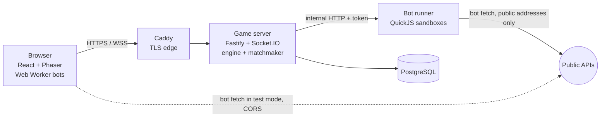

# Architecture

## Trust model

| Mode          | Where bot code runs                | Rated | Why                                                          |
| ------------- | ---------------------------------- | ----- | ------------------------------------------------------------ |
| Local test    | The player's browser (Web Worker)  | No    | Instant feedback, code never leaves the machine.             |
| Online casual | Each player's browser              | No    | Friends play together; the server only trusts the decisions. |
| Ranked        | Server side, in the QuickJS runner | Yes   | The only mode where the server controls every input.         |

Only results the server computed itself, with code it stored as an immutable bot
version, change ratings.

## Determinism and replays

- The engine (`packages/game-engine`) is pure: the state carries its own Mulberry32
  RNG, time is a tick counter (50 ms), and `step()` has a fixed phase order.
- Each bot is asked for a decision once per turn; the turn length follows the
  player's speed (`turnTicks`: 8, 6, 5 or 4 ticks, 6 at the start). In real-time
  matches the loop (`runMatch`) never waits: it sends the observations, keeps ticking,
  and applies each answer on the tick it arrives. Answers still missing at that
  player's next turn (after `turnBudgetMs`, at most `DECISION_BUDGET_MS` = 240 ms) are
  dropped and that player skips the turn.
- Engine v2 introduced per-player turns and v3 slowed them to the legacy pace.
  `createGame` still accepts `engineVersion: 1` and `2`, so matches recorded before
  keep replaying under their rules.
  With `tickMs: 0` (offline simulation, tests) the loop runs in lockstep instead.
- Accepted intents are recorded as `(tick, slot, intent)` with the tick they were
  applied at, and stored in `match_events`.
- `runReplay(seed, settings, intents)` re-simulates a match exactly; the stored
  `final_hash` (FNV-1a over the state) lets anyone verify a replay. Bomber Arena TV
  re-simulates replays in the browser and shows whether the hash matches.
- A shared harness (`BOT_HARNESS`) gives both bot runtimes the same semantics: seeded
  `Math.random`, `Date`/`performance.now()` frozen to the game tick, captured
  console, and the same `fetch`. Bots can still depend on timing and outside
  services, so replays never re-run bots: they re-apply the recorded intents.
- Every harness `call` has an id; a promise from an earlier turn that settles late is
  ignored, so a stale answer can never be applied to a later turn.

## Bot execution

**Browser:** a module Web Worker evaluates the harness and the bot, then removes
storage, timer, socket, and messaging globals. `fetch` goes through a host function
with the same limits as the server (`FETCH_LIMITS`), sent with `credentials: 'omit'`,
so a bot cannot act on the player's account. The worker script is served with its
own CSP (`connect-src https: http:`). The worker acknowledges each call when its
synchronous code returns; a watchdog terminates a worker that does not acknowledge
within 1.5 s.

**Ranked (bot-runner):** each bot gets its own QuickJS runtime (WebAssembly) inside a
worker thread pool:

- 32 MB heap, 512 KB stack, 1 s to load, 100 ms of CPU for each synchronous run (the
  call itself, or a batch of promise callbacks), enforced by the interrupt handler;
- the decision budget is wall clock: the runner waits for the bot's promise until
  the budget sent by the server, then reports a skipped turn;
- the only host function is `__bomberHostFetch`, wrapped by the harness `fetch`; no
  `require`, filesystem, or timers;
- 20 consecutive crashes or CPU overruns, or an out of memory error, disable the
  bot for the match; skipped turns do not count;
- the container is read only, drops all capabilities, and is reachable only on the
  internal `sandbox` network with a shared bearer token. It also joins the `egress`
  network for bot requests, and never shares a network with PostgreSQL.

**Bot requests (`apps/bot-runner/src/egress.ts`):** undici with a custom DNS lookup.
Every resolved address is checked when the socket connects, so a hostname cannot pass
the check and then rebind to an internal address. Loopback, private, link-local
(cloud metadata), carrier-grade NAT, multicast, documentation, and IPv6 transition
ranges are refused, as are literal IPs in those ranges, ports below 1024 other than
80 and 443, URLs with credentials, and `cookie`, `host`, and hop-by-hop headers.
Redirects are followed by hand (at most 3) so every hop is checked again. Each bot
gets 4 concurrent and 200 total requests per match, a 5 s timeout, a 64 KB request
body, and a 256 KB response. `BOT_FETCH=off` disables network access entirely.

## Server

- **HTTP** (`apps/server/src/http`): Fastify 5 with helmet (strict CSP; `unsafe-eval`
  only on the worker script), rate limits, zod validation, structured pino logs, and
  `/healthz` (liveness) plus `/readyz` (database and runner).
- **Auth**: usernames are NFKC normalized and lowercased; passwords are Argon2id
  (19 MiB, t=2). Sessions are random 256 bit tokens in `HttpOnly; SameSite=Lax`
  cookies (`__Host-` prefixed over HTTPS); only their SHA-256 is stored. Every state
  change needs the session's CSRF token and an allowed `Origin`. Logins, failures,
  password changes, and submissions are written to `audit_log`.
- **Arena** (`apps/server/src/arena`): runs matches in real time, streams snapshots to
  the `match:<id>` Socket.IO room, then stores the outcome, the replay log, and rating
  changes in one transaction. Matches interrupted by a restart are marked aborted.
- **Matchmaker**: the queued bot that waited longest anchors the match. Up to three
  opponents are chosen by smallest absolute rating gap, with queue order breaking
  ties, and a player can occupy only one seat per ranked match. If that global anchor
  is still playing, matchmaking waits instead of rematching newer available bots;
  it also waits rather than filling a partial human lineup while other queued bots
  are busy. This prevents concurrent matches from becoming permanent cohorts. House
  bots (the public samples) fill empty seats only when no running queued bot could
  complete the lineup. Concurrency is capped by `RANKED_CONCURRENCY`.
- **Ratings**: multiplayer Elo. Each match is scored as every pairwise duel
  (K = 32 scaled by 1 / (n − 1)); ties share points. `npm run ratings:rebuild`
  recomputes everything from stored placements.

## Data model

| Table                | Purpose                                                                   |
| -------------------- | ------------------------------------------------------------------------- |
| `users`              | Username, display name, Argon2id hash, `is_house` for the system account. |
| `sessions`           | Token hash, CSRF token, expiry (sliding, 30 days by default).             |
| `bots`               | Owner, name, active version; soft deleted so history stays intact.        |
| `bot_versions`       | Immutable source, SHA-256, SDK version, visibility (enforced by trigger). |
| `ranked_queue`       | Bots waiting for ranked play and when they last played.                   |
| `matches`            | Kind, status, seed, settings, engine version, final hash, winner.         |
| `match_participants` | Slot, bot version, placement, stats, rating before and after.             |
| `match_events`       | The replay log: `(seq, tick, slot, intent)`.                              |
| `ratings`            | Current rating, games, wins per bot.                                      |
| `audit_log`          | Security relevant events.                                                 |

Migrations live in `apps/server/src/db/migrations` and run at startup under a
PostgreSQL advisory lock (or with `npm run db:migrate`).

## Realtime protocol

Socket.IO 4 on `/socket.io`, same origin only. Anonymous sockets may watch; playing
online needs a session cookie. Events are typed in `packages/protocol/src/realtime.ts`:
`match:watch`, `match:snapshot`, `match:end`, `match:chat`, `match:viewers`,
`casual:create|join|start|leave`, `casual:lobby`, `casual:match`, and `bot:observe`
(server asks a browser for a move). `match:viewers` counts the sockets in a match room.
Match chat is in memory only and lives as long as the match plus two minutes, so
spectators can talk through the result: signed-in spectators in the match room and the
match's bots (`SAY …` actions) may each post one line per second; `match:watch` returns
the last 100 lines. Bomber Arena TV keeps the last 100 lines across matches.
The original 2020 protocol and the rule changes since are documented in
[legacy-protocol.md](legacy-protocol.md).
